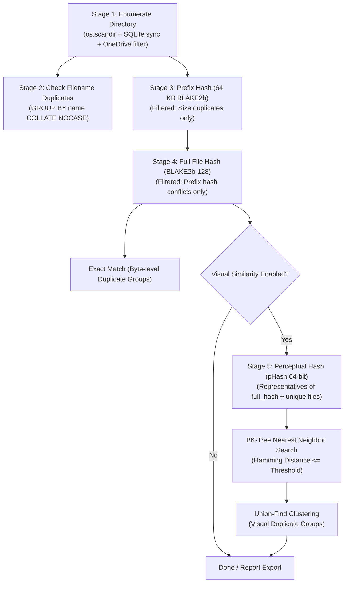

# duplicate_image_finder — Agent & Developer Guide

`duplicate_image_finder` is a high-performance, resilient duplicate and similar image detection system designed to efficiently process large-scale image collections (ranging from tens of thousands to millions of files).

This document serves as the primary technical reference and architectural guide for AI agents and developers maintaining, extending, or operating this codebase.

---

## 1. Project Overview

The project provides dual implementations catering to different scale requirements:

1. **`duplicate_image_finder_v2.py` (Primary / Production)**:
   - Built specifically for massive image datasets (100k~1M+ files).
   - Employs a **5-stage hierarchical funnel architecture** (inspired by tools like `Czkawka` and `fclones`).
   - SQLite WAL-mode persistence for full **breakpoint resumption** and zero-overhead **incremental scanning**.
   - Multi-process parallel hashing (`ProcessPoolExecutor`) and sub-quadratic metric space search via **BK-Tree** and **Union-Find** clustering.
   - Platform-aware (detects and skips Windows OneDrive cloud-only placeholder files).

2. **`duplicate_image_finder.py` (v1 / Utility)**:
   - Lightweight, standalone script for small datasets (<10k images).
   - Provides pairwise $O(N^2)$ distance matrices, multiple perceptual hash algorithms (`phash`, `ahash`, `dhash`, `whash`), and interactive file deletion modes (`--delete`, `--keep first|largest|resolution`, `--no-dry-run`).

---

## 2. Repository Structure

```
duplicate_image_finder/
│
├── duplicate_image_finder_v2.py      # [Main] Scalable, multi-process duplicate finder with SQLite & BK-tree
├── duplicate_image_finder.py         # [v1] Lightweight standalone script with direct deletion support
│
├── requirements.txt                  # Production dependencies (pillow, imagehash, tqdm)
├── dependencies.md                   # Detailed environment and deployment guide (online/offline/Pillow-SIMD)
├── duplicate_image_finder_readme.md  # User documentation for v1 script
├── chat_history_2026-09-01_17-21.md  # Architecture design decisions and historical chat context
│
├── image_dedup.db                    # SQLite cache database (created/updated at runtime)
├── image_dedup.db-wal                # SQLite Write-Ahead Log (runtime temporary)
├── image_dedup.db-shm                # SQLite Shared-Memory index (runtime temporary)
│
└── agent.md                          # [This file] Developer and AI agent reference manual
```

---

## 3. Architecture & Core Algorithms

### 3.1 Hierarchical Funnel Pipeline (v2)

To avoid computing expensive image decodings and perceptual hashes across millions of files, `v2` filters files through progressively stricter and more computationally intensive stages:



| Stage | Operation | Computation Cost | Target Set / Filter |
|---|---|---|---|
| **1. Enumerate** | Recursive scan + metadata sync `(size, mtime)` | Low (Disk I/O) | All files in directory |
| **2. Name Duplicates** | SQL `GROUP BY name COLLATE NOCASE` | Negligible | All indexed files |
| **3. Prefix Hash** | Read first 64 KB $\rightarrow$ BLAKE2b hash | Low (Sequential read) | Files sharing exact byte size |
| **4. Full Hash** | Stream whole file $\rightarrow$ BLAKE2b-128 hash | Moderate | Files sharing size & prefix hash |
| **5. Visual Hash** | Image decode (`draft('L', (64,64))`) $\rightarrow$ pHash | High (CPU decoding) | Unique representative per exact group |
| **6. Clustering** | BK-Tree index search + Union-Find | Low ($O(M \log M)$) | Representative pHash 64-bit integers |

### 3.2 Key Data Structures & Optimizations

- **SQLite WAL & Incremental Cache**:
  - `PRAGMA journal_mode=WAL` and `PRAGMA synchronous=NORMAL`.
  - Cache key: `(path, size, mtime)`. Unchanged files skip re-reading.
  - Transactions batched every 5,000 records (`BATCH = 5000`).
- **Fast Image Downsampling**:
  - `im.draft('L', (64, 64))` is called before `imagehash.phash`, accelerating JPEG decoding significantly.
- **Fast BK-Tree Metric Space Search**:
  - 64-bit hashes stored as unsigned integers (`int(h, 16)`).
  - Hamming distance calculated via `(h1 ^ h2).bit_count()` (native C speed in Python 3.10+).
  - Prunes subtree branches outside `[d - threshold, d + threshold]`.
- **Windows OneDrive Placeholder Bypass**:
  - Checks Win32 attributes `FILE_ATTRIBUTE_OFFLINE (0x1000)`, `FILE_ATTRIBUTE_RECALL_ON_OPEN (0x40000)`, `FILE_ATTRIBUTE_RECALL_ON_DATA_ACCESS (0x400000)` via `kernel32.GetFileAttributesW`. Prevents accidental cloud downloads.
- **Large Image / Gigapixel Support**:
  - Sets `Image.MAX_IMAGE_PIXELS = None` and suppresses `Image.DecompressionBombWarning` across both main and multiprocessing workers to allow scanning ultra-high-resolution images without warnings or DOS-protection errors.

---

## 4. Database Schema (`image_dedup.db`)

```sql
CREATE TABLE IF NOT EXISTS files (
    id           INTEGER PRIMARY KEY,
    path         TEXT NOT NULL UNIQUE,
    name         TEXT NOT NULL,
    size         INTEGER NOT NULL,
    mtime        REAL NOT NULL,
    prefix_hash  TEXT,              -- Hex string: BLAKE2b of first 64KB
    full_hash    TEXT,              -- Hex string: BLAKE2b-128 of entire file
    phash        TEXT,              -- Hex string: 64-bit pHash
    visual_group INTEGER,           -- Clustered group ID for visual duplicates
    error        TEXT               -- Error message if decode or read failed
);

CREATE INDEX IF NOT EXISTS ix_files_size ON files(size);
CREATE INDEX IF NOT EXISTS ix_files_size_prefix ON files(size, prefix_hash);
CREATE INDEX IF NOT EXISTS ix_files_name ON files(name COLLATE NOCASE);
CREATE INDEX IF NOT EXISTS ix_files_full ON files(full_hash);
CREATE INDEX IF NOT EXISTS ix_files_vg   ON files(visual_group);

CREATE TABLE IF NOT EXISTS meta (
    key   TEXT PRIMARY KEY,
    value TEXT
);
```

### Metadata Keys in `meta`:
- `root`: Absolute path of the last scanned directory.
- `visual_done`: `'1'` when visual clustering completed for current database state.
- `threshold`: Integer hamming distance threshold used for visual clustering.

---

## 5. Environment & Dependencies

### Runtime Requirements
- **Python**: 3.10+ (Required for `int.bit_count()`; tested on Python 3.12).
- **Supported OS**: Windows 10/11, Linux, macOS.

### Dependencies
Install via `requirements.txt`:
```bash
pip install -r requirements.txt
```

Core libraries:
- `pillow >= 10.0`: Image decoding.
- `imagehash >= 4.3`: Perceptual hashing (pulls `numpy`, `scipy`, `PyWavelets`).
- `tqdm >= 4.60`: Progress bar handling.

*(Optional)* Performance accelerator:
- `pillow-simd`: 2x~4x faster SIMD-accelerated JPEG/PNG decoding (must uninstall `pillow` before installing `pillow-simd`).

---

## 6. Usage & CLI Reference

### 6.1 `duplicate_image_finder_v2.py`

#### Interactive Mode
Run without arguments to launch the interactive terminal menu:
```bash
python duplicate_image_finder_v2.py
```
Menu options:
- `[1]`: Start / Resume duplicate search (breakpoint continuation).
- `[2]`: Fresh scan (clears database cache).
- `[3]`: Export duplicate reports (CSV + Markdown).
- `[4]`: Toggle error handling mode (Pause for `r` retry vs. Auto-skip errors).
- `[0]`: Exit.

#### Command-Line Mode
```bash
# Resume or start scan on target directory
python duplicate_image_finder_v2.py scan "E:\photos"

# Fresh scan (wipe cache and rescan)
python duplicate_image_finder_v2.py scan "E:\photos" --fresh

# Automatic error skipping without pausing for retry
python duplicate_image_finder_v2.py scan "E:\photos" --auto-skip-errors

# Byte-level duplicate scan only (skip visual pHash stage)
python duplicate_image_finder_v2.py scan "E:\photos" --no-visual

# Custom visual threshold and worker processes
python duplicate_image_finder_v2.py scan "E:\photos" --threshold 6 --workers 8

# Export reports from existing database without rescanning
python duplicate_image_finder_v2.py export
```

#### Output Artifacts:
- `duplicates_report.csv`: UTF-8 with BOM (compatible with Microsoft Excel), formatted horizontally as: `filename, dup_path_1, dup_path_2, dup_path_3, ...`.
- `duplicates_report.md`: Markdown summary and grouped duplicate listings with file sizes.

---

### 6.2 `duplicate_image_finder.py` (v1)

```bash
# Basic scan with pHash
python duplicate_image_finder.py /path/to/photos

# Use dHash with strict threshold
python duplicate_image_finder.py /path/to/photos -a dhash -t 8 -v

# Safe dry-run deletion preview
python duplicate_image_finder.py /path/to/photos --delete --keep largest

# Execute real deletion
python duplicate_image_finder.py /path/to/photos --delete --keep largest --no-dry-run
```

---

## 7. Developer & Agent Guidelines

When modifying, debugging, or adding features to this codebase, adhere to the following rules:

### 7.1 SQLite & Concurrency
- **Multi-Process Database Access**: In `v2`, worker functions (`hash_chunk`, `phash_chunk`) are pure stateless functions that accept `(id, path)` pairs and return digests. **Do not open SQLite connections inside worker processes**. All database updates must remain in the main process loop.
- **Transaction Batching**: Keep `CHUNK_SIZE = 2000` and `BATCH = 5000` to prevent SQLite lock thrashing and maintain high throughput.
- **Preserving Resume Capability**: Always reset `prefix_hash=NULL, full_hash=NULL, phash=NULL, visual_group=NULL` when a file's `size` or `mtime` changes.

### 7.2 Adding New Features
- **Implementing Automated Deletion in v2**:
  - If adding automated deletion to `v2`, ensure it defaults to **dry-run** mode.
  - Deletion rules should prioritize:
    1. Exact content duplicates (`full_hash` matches) first.
    2. Respect retention policies: `largest` (highest file size), `resolution` (highest image width $\times$ height), or `path_priority` (keep originals in specified folders).
    3. Update `files` table or delete rows upon file removal.
- **Adding Custom Hashes / Embeddings**:
  - For semantic/deep learning embeddings (e.g. CLIP), add an `embedding BLOB` column to `files` table.
  - Implement a dedicated stage after `stage_full_hash` to only embed unique file representatives.

### 7.3 Windows Platform Specifics
- Always preserve Windows path compatibility (use `os.path.abspath` and handle paths $\ge 250$ chars with `\\?\` prefix if needed).
- Maintain `is_placeholder(path)` check in `enumerate_into_db` to avoid hanging scans on cloud storage mount points.
