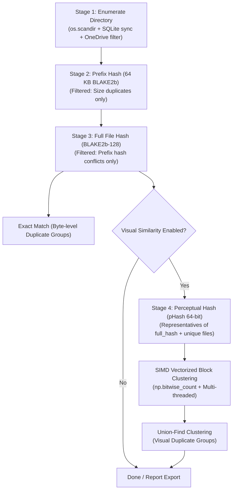

# duplicate_image_finder — Agent & Developer Guide

`duplicate_image_finder` is a high-performance, resilient duplicate and similar image detection system designed to efficiently process large-scale image collections (ranging from tens of thousands to millions of files).

This document serves as the primary technical reference and architectural guide for AI agents and developers maintaining, extending, or operating this codebase.

---

## 1. Project Overview

`duplicate_image_finder_v2.py` is the production duplicate image detection system:
- Built specifically for massive image datasets (100k~1M+ files).
- Employs a **4-stage hierarchical funnel architecture** (inspired by tools like `Czkawka` and `fclones`).
- SQLite WAL-mode persistence for full **breakpoint resumption** and zero-overhead **incremental scanning**.
- Multi-process parallel hashing (`ProcessPoolExecutor`) and hardware SIMD vectorized multi-threaded clustering (`np.bitwise_count` + `UnionFind`).
- Platform-aware (detects and skips Windows OneDrive cloud-only placeholder files).

---

## 2. Repository Structure

```
duplicate_image_finder/
│
├── duplicate_image_finder_v2.py      # [Main] Production duplicate finder with SQLite & SIMD clustering
│
├── requirements.txt                  # Production dependencies (pillow, imagehash, tqdm, numpy)
├── install_dependencies.bat          # Windows batch script for automated dependency setup
├── README.md                         # User documentation, feature overview & usage guide
│
├── image_dedup.db                    # SQLite cache database (created/updated at runtime)
│
└── agent.md                          # [This file] Developer and AI agent reference manual
```

---

## 3. Architecture & Core Algorithms

### 3.1 Hierarchical Funnel Pipeline (v2)

To avoid computing expensive image decodings and perceptual hashes across millions of files, `v2` filters files through progressively stricter and more computationally intensive stages:



| Stage | Operation | Computation Cost | Target Set / Filter |
|---|---|---|---|
| **1. Enumerate** | Recursive scan + metadata sync `(size, mtime)` | Low (Disk I/O) | All files in directory |
| **2. Prefix Hash** | Read first 64 KB $\rightarrow$ BLAKE2b hash | Low (Sequential read) | Files sharing exact byte size |
| **3. Full Hash** | Stream whole file $\rightarrow$ BLAKE2b-128 hash | Moderate | Files sharing size & prefix hash |
| **4. Visual Hash & Cluster** | Image decode $\rightarrow$ pHash 64-bit $\rightarrow$ SIMD Block Clustering | High (Decode) / Fast (Cluster) | Unique representative per exact group |

### 3.2 Key Data Structures & Optimizations

- **SQLite WAL & Incremental Cache**:
  - `PRAGMA journal_mode=WAL` and `PRAGMA synchronous=NORMAL`.
  - Cache key: `(path, size, mtime)`. Unchanged files skip re-reading.
  - Transactions batched every 5,000 records (`BATCH = 5000`).
- **Fast Image Downsampling**:
  - `im.draft('L', (64, 64))` is called before `imagehash.phash`, accelerating JPEG decoding significantly.
- **Hardware SIMD Vectorized Multi-Threaded Clustering**:
  - Employs NumPy 2.x `np.bitwise_count` leveraging CPU hardware SIMD (AVX2 / AVX-512 `POPCNT`) instructions.
  - Divides 64-bit hash matrix into cache-friendly blocks ($2,000 \times 2,000$) and evaluates block pairs in parallel across user-configured worker threads.
- **Windows OneDrive Placeholder Bypass**:
  - Checks Win32 attributes `FILE_ATTRIBUTE_OFFLINE (0x1000)`, `FILE_ATTRIBUTE_RECALL_ON_OPEN (0x40000)`, `FILE_ATTRIBUTE_RECALL_ON_DATA_ACCESS (0x400000)` via `kernel32.GetFileAttributesW`. Prevents accidental cloud downloads.
- **Large Image / Gigapixel Support**:
  - Sets `Image.MAX_IMAGE_PIXELS = None` and suppresses `Image.DecompressionBombWarning` across both main and multiprocessing workers to allow scanning ultra-high-resolution images without warnings or DOS-protection errors.

---

## 4. Database Schema (`image_dedup.db`)

```sql
CREATE TABLE IF NOT EXISTS files (
    id           INTEGER PRIMARY KEY,
    path         TEXT NOT NULL UNIQUE,
    name         TEXT NOT NULL,
    size         INTEGER NOT NULL,
    mtime        REAL NOT NULL,
    prefix_hash  TEXT,              -- Hex string: BLAKE2b of first 64KB
    full_hash    TEXT,              -- Hex string: BLAKE2b-128 of entire file
    phash        TEXT,              -- Hex string: 64-bit pHash
    visual_group INTEGER,           -- Clustered group ID for visual duplicates
    error        TEXT               -- Error message if decode or read failed
);

CREATE INDEX IF NOT EXISTS ix_files_size ON files(size);
CREATE INDEX IF NOT EXISTS ix_files_size_prefix ON files(size, prefix_hash);
CREATE INDEX IF NOT EXISTS ix_files_name ON files(name COLLATE NOCASE);
CREATE INDEX IF NOT EXISTS ix_files_full ON files(full_hash);
CREATE INDEX IF NOT EXISTS ix_files_vg   ON files(visual_group);

CREATE TABLE IF NOT EXISTS meta (
    key   TEXT PRIMARY KEY,
    value TEXT
);
```

### Metadata Keys in `meta`:
- `root`: Absolute path of the last scanned directory.
- `visual_done`: `'1'` when visual clustering completed for current database state.
- `threshold`: Integer hamming distance threshold used for visual clustering.

---

## 5. Environment & Dependencies

### Runtime Requirements
- **Python**: 3.10+ (Required for `int.bit_count()`; tested on Python 3.12).
- **Supported OS**: Windows 10/11, Linux, macOS.

### Dependencies
Install via `requirements.txt`:
```bash
pip install -r requirements.txt
```

Core libraries:
- `pillow >= 10.0`: Image decoding.
- `imagehash >= 4.3`: Perceptual hashing (pulls `numpy`, `scipy`, `PyWavelets`).
- `tqdm >= 4.60`: Progress bar handling.

*(Optional)* Performance accelerator:
- `pillow-simd`: 2x~4x faster SIMD-accelerated JPEG/PNG decoding (must uninstall `pillow` before installing `pillow-simd`).

---

## 6. Usage & CLI Reference

### 6.1 `duplicate_image_finder_v2.py`

#### Interactive Mode
Run without arguments to launch the interactive terminal menu:
```bash
python duplicate_image_finder_v2.py
```
Menu options:
- `[1]`: Start / Resume duplicate search on main database (breakpoint continuation).
- `[2]`: Fresh scan main database (clears and rebuilds cache).
- `[3]`: Export main duplicate reports (CSV + Markdown).
- `[4]`: Temporary isolated scan (runs in `image_dedup_temp.db` without contaminating main DB, exports `_temp` reports).
- `[5]`: Optimize & clean database (defragments SQLite pages via `VACUUM` & rebuilds statistics via `ANALYZE`).
- `[6]`: Toggle error handling mode (Pause for `r` retry vs. Auto-skip errors).
- `[7]`: Clean Mac junk files (safely scans and deletes `._*` AppleDouble and `.DS_Store` files with confirmation).
- `[8]`: Delete duplicate files from scan results (keeps exactly one file per duplicate group per the retention policy, sends the rest to the OS Recycle Bin, syncs the index, and reports reclaimed space). Operates on **either the main DB or a kept temporary scan DB** — if `image_dedup_temp.db` exists, the menu first asks which one to use.
- `[0]`: Exit.

#### Command-Line Mode
```bash
# Resume or start scan on target directory (main database)
python duplicate_image_finder_v2.py scan "E:\photos"

# Temporary isolated scan (one-time test scan, exports _temp reports)
python duplicate_image_finder_v2.py scan "E:\photos" --temp

# Fresh scan (wipe cache and rescan)
python duplicate_image_finder_v2.py scan "E:\photos" --fresh

# Skip directory walking and directly continue unfinished hashing/clustering
python duplicate_image_finder_v2.py scan "E:\photos" --skip-walk

# Automatic error skipping without pausing for retry
python duplicate_image_finder_v2.py scan "E:\photos" --auto-skip-errors

# Byte-level duplicate scan only (skip visual pHash stage)
python duplicate_image_finder_v2.py scan "E:\photos" --no-visual

# Custom visual threshold and worker processes
python duplicate_image_finder_v2.py scan "E:\photos" --threshold 6 --workers 8

# Export reports from existing database without rescanning
python duplicate_image_finder_v2.py export

# Optimize and defragment SQLite database
python duplicate_image_finder_v2.py clean-db

# Clean macOS metadata junk files (._* and .DS_Store)
python duplicate_image_finder_v2.py clean-junk "E:\photos"
```

#### Output Artifacts:
- `duplicates_report.csv` / `duplicates_report_temp.csv`: UTF-8 with BOM (compatible with Microsoft Excel), formatted horizontally as: `filename, dup_path_1, dup_path_2, dup_path_3, ...`.
- `duplicates_report.md` / `duplicates_report_temp.md`: Markdown summary and grouped duplicate listings with file sizes.

---

## 7. Developer & Agent Guidelines

When modifying, debugging, or adding features to this codebase, adhere to the following rules:

### 7.1 SQLite & Concurrency
- **Multi-Process Database Access**: In `v2`, worker functions (`hash_chunk`, `phash_chunk`) are pure stateless functions that accept `(id, path)` pairs and return digests. **Do not open SQLite connections inside worker processes**. All database updates must remain in the main process loop.
- **Transaction Batching**: Keep `CHUNK_SIZE = 2000` and `BATCH = 5000` to prevent SQLite lock thrashing and maintain high throughput.
- **Preserving Resume Capability**: Always reset `prefix_hash=NULL, full_hash=NULL, phash=NULL, visual_group=NULL` when a file's `size` or `mtime` changes.

### 7.2 Adding New Features
- **Automated Deletion (implemented — interactive menu `[8]`, `delete_duplicates`)**:
  - Entry point: interactive menu `[8]` only (no CLI subcommand). **Target DB selection**: the temp DB path is derived as `os.path.join(os.path.dirname(os.path.abspath(db_path)), TEMP_DB_FILENAME)`; if it exists, the menu status shows a `临时数据库` line with its indexed count, and `[8]` asks `[1] 主库 / [2] 临时库` before opening. `delete_duplicates` then prints the DB path (labelled `[主库]`/`[临时库]`) plus its `root` metadata, and returns to the menu if the DB has zero files (the hint points to option `4` for the temp DB). The operator picks the category at runtime (`1` exact `full_hash` / `2` visual `visual_group` / `3` both).
  - **Retention policy — keep exactly one per group (descending max)**: ① largest `size` → ② newest `mtime` **date only** (year/month/day via `time.localtime`, time-of-day ignored) → ③ largest `name` lexicographically, case-insensitive (`name.lower()`). Implemented in `_recycle_key`.
  - **Deletion is recoverable**: files are sent to the OS Recycle Bin, never permanently erased. `move_to_trash` degrades as `send2trash` → Windows `shell32.SHFileOperationW` (`FOF_ALLOWUNDO`) → `os.remove`, returning `(deleted, failed, skipped)`.
  - **Judge success by filesystem state, not the return code**: `SHFileOperationW`'s return value is unreliable (it can return non-zero even after a successful delete), so per-path success is decided by `os.path.exists()`.
  - For `both` mode, a `scheduled` set prevents the same file from being scheduled twice (exact group first, then visual group).
  - After deletion, purge the corresponding `files` rows in `BATCH`-sized chunks (`DELETE ... WHERE path IN (...)`, incl. already-missing paths) and `commit()`.
  - **Guideline for future retention options** (e.g. `resolution` = highest width×height, or `path_priority` = keep originals in specified folders): add them as new key components in `_recycle_key` rather than rewriting the loop.
- **Adding Custom Hashes / Embeddings**:
  - For semantic/deep learning embeddings (e.g. CLIP), add an `embedding BLOB` column to `files` table.
  - Implement a dedicated stage after `stage_full_hash` to only embed unique file representatives.

### 7.3 Windows Platform Specifics
- Always preserve Windows path compatibility (use `os.path.abspath` and handle paths $\ge 250$ chars with `\\?\` prefix if needed).
- Maintain `is_placeholder(path)` check in `enumerate_into_db` to avoid hanging scans on cloud storage mount points.
